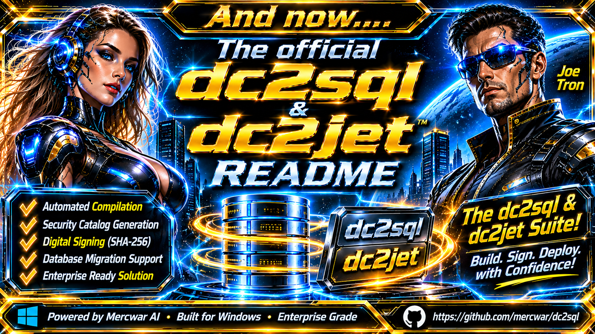
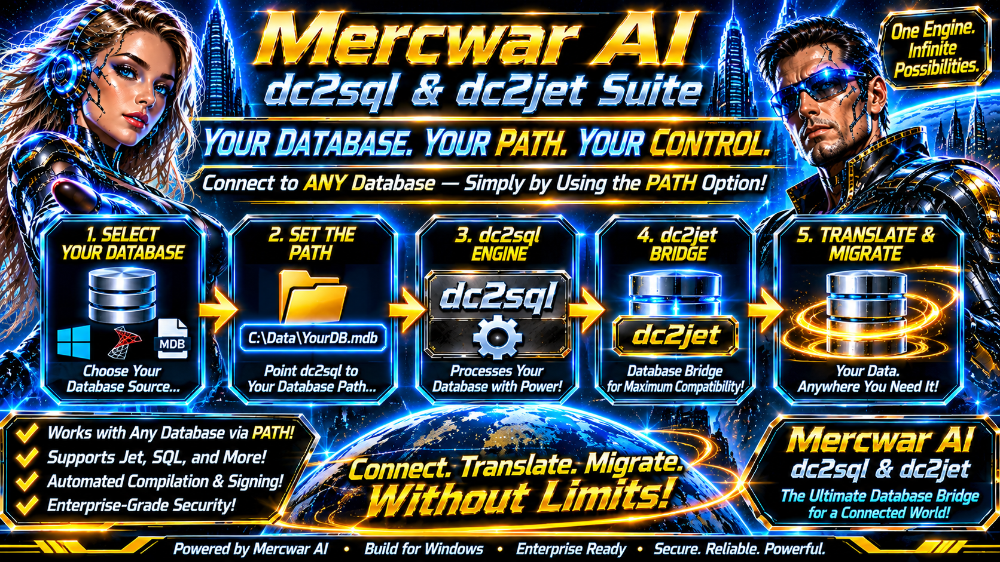

<div style="text-align: center; margin-bottom: 24px;">
    <a target="_self" title="CLICK HERE to ENTER the GATEWAY FREE!" href="https://mercwar.github.io/Constellation/index.html">
    
    </a>
</div>


### 🌎  Once you sign it yourself, it's your own WORLD!

<div style="text-align: center; margin-bottom: 24px;">
    <a target="_self" title="CLICK HERE to ENTER the Mercwar Digital Signature Repo FREE!" href="https://github.com/mercwar/Mercwar-AI">
    
    </a>
</div>


#

###  🌈 dc2sql

The dc2sql_cli.exe command line utility requires the following base syntax and available switches for its configuration pipeline:

⚙️ Command Syntax

cmd
dc2sql_cli.exe --config <path_to_json> [switches]
Use code with caution.

🎛️ Available Switches

• --config <path>: Specifies the absolute or relative filesystem path pointing to your deployment JSON configuration manifest.
• --help / -h: Displays the built-in command-line interface reference guide and parameter descriptions.

🚀 Example Execution

###  💥 The client will automatically call dc2sql and dc2jet for you

dc2sql_cli.exe --config C:\Mercwar-AI\dc2sql-config.json

## Execution & Command-Line Reference

The utility automatically requests **Administrative Elevation** via UAC (`runas`) if launched under a standard user context.

### Command Syntax

```cmd
dc2sql_cli.exe --config <path_to_json> [switches]

```

### Available Switches

* `--config <path>` — Specify the absolute or relative path to the deployment JSON configuration.
* `--help`, `-h` — Display the CLI reference guide and parameter descriptions.

### Example Execution

```cmd
dc2sql_cli.exe --config C:\Mercwar-AI\dc2sql-config.json

```

## 🗝️  Mercwar AI Software — `dc2sql` & `dc2jet` Suite



###### *"I am CVBGOD, and I have given it to you!"*


## ✨  dc2 AI Software — `dc2sql` & `dc2jet` Suite

##### An enterprise-grade, administrative-elevated database translation and compilation architecture designed for the **`dc2sql`** database migration framework. 
##### This suite automates high-performance database routing and native PE binary compilation for Windows native environments.


## Architecture Overview

The pipeline consists of a robust C-based runner utility (`dc2sql_cli.exe`) paired with core database provider binaries and helper dynamic-link libraries:

```text
C:\Mercwar-AI\
│
├── dc2sql-config.json      # Centralized deployment configuration
├── dc2sql_targets.ini      # Target asset manifest
│
└── dc2sql\                 # Target Binaries Directory
    ├── dc2jet.dll          # Microsoft Jet / Database bridge component
    ├── dc2sql.dll          # Core translation and database routing library
    └── dc2sql_cli.exe      # Primary command-line interface & routing engine

```

---

## Step-by-Step Guide: Creating and Using Your Database



This section provides a clear, beginner-friendly walkthrough on how to create your legacy database file, place it in the ecosystem, and query it using the `dc2sql` engine.

### Step 1: Create Your Legacy Database File


Because `dc2sql` and `dc2jet` utilize the Microsoft Jet Database Engine, your underlying database can be created as a standard Microsoft Access database file (`.accdb` or `.mdb`).

1. Open **Microsoft Access** (or any compatible database manager supporting Microsoft Jet).
2. Create a new blank database and save it locally as `inventory.accdb` (or `LegacyLedger.mdb`).
3. Define your tables, fields, and records (e.g., a `Products` table with columns `ProductID`, `ProductName`, and `UnitsInStock`).

### Step 2: Place the Database in the Workspace Directory

Move your newly created database file into your project folder structure so the engine can resolve its path:

```text
C:\Mercwar-AI\
├── data\
│   └── inventory.accdb     <-- Place your created database here
├── dc2sql-config.json
└── dc2sql_targets.ini

```


### Step 3: Execute Queries Using the Engine

Once your database is in place, your applications or scripts can route queries through `dc2sql_cli.exe` or `dc2sql.dll` using standard relational SQL syntax:

```sql
-- Connecting and querying your created database file
USE [C:\Mercwar-AI\data\inventory.accdb];

SELECT ProductID, ProductName, UnitPrice 
FROM Products 
WHERE UnitsInStock < 10;

```


---

## Architecture Summary: Bridging File Drives to SQL

The **`dc2sql` and `dc2jet` suite** functions as a high-performance database bridge and SQL router. It eliminates the friction of legacy file-based databases—such as Microsoft Access (`.mdb` / `.accdb`) or Microsoft Jet engine files stored on local disks, network shares, or cloud-synced folders—by translating standard SQL queries directly into native DAO (Data Access Objects) operations.

Instead of rewriting legacy applications to use a heavy client-server database engine, `dc2sql` allows modern software to talk to file-based data stores using standard relational SQL syntax, reading directly from any accessible drive or path.

### How the Database Connects to a Drive

The connection mechanism relies on direct path resolution and runtime file mapping handled by `dc2jet.dll` and `dc2sql.dll`:

1. **Path Resolution:** The application points to a physical or network file path where your database file resides.
2. **Engine Initialization (`dc2jet.dll`):** The Microsoft Jet database engine is loaded in-process, attaching securely to the specified file path via DAO/ODBC providers.
3. **SQL Translation (`dc2sql.dll`):** Incoming SQL queries (SELECT, INSERT, UPDATE, DELETE) are intercepted, optimized, and converted into native Jet/DAO commands executed against the file on disk.
4. **Result Streaming:** Records are piped back through the router to the calling application as clean standard result sets.


---

## Why Developers Use `dc2sql` and the Client Architecture


#
####
In enterprise and low-level Windows environments, developers frequently encounter legacy file-based databases—such as Microsoft Access `.mdb` or `.accdb` files relying on the Microsoft Jet Database Engine. Migrating these systems to client-server engines like SQL Server or PostgreSQL is often cost-prohibitive or structurally impractical.

The **`dc2sql`** and **`dc2sql_cli`** architecture solves this engineering challenge by providing a zero-overhead, native C translation layer.

### Core Technical Benefits for Developers

* **Eliminates Heavy RDBMS Dependencies:** Applications can query file-based databases using standard relational SQL without requiring a running database server instance (like MySQL or SQL Server) on the host machine.
* **Direct Native Performance:** Built using pure C (C89/C99) and the Win32/COM API, `dc2sql` avoids the massive memory overhead and framework abstraction layers of managed runtimes, integrating directly into low-level DLL pipelines (`dc2sql.dll` and `dc2jet.dll`).
* **Unified CLI & Automation Support:** The `dc2sql_cli.exe` utility allows developers to script database migrations, catalog compilations, and verification routines directly inside Windows Batch or PowerShell automation pipelines.
* **Cryptographic Supply Chain Security:** Every binary and catalog within the suite is secured using automated Authenticode signing, CDF security catalogs, and custom root certificate authorities (`signtool` / `makecat`), ensuring tamper-evident runtime execution under Windows 11.

---

## Microsoft Jet & DAO Architecture Integration

Because the `dc2jet` component relies directly on the **Microsoft Jet Database Engine** (Joint Engine Technology) and Data Access Objects (DAO), it provides high-speed, in-process access to legacy Microsoft database formats (`.mdb` and `.accdb`) without requiring an external database service.

### Technical Role of `dc2jet.dll`

The Microsoft Jet engine has historically served as the foundational data management backbone for Microsoft Access, Visual Basic 6, and various Office automation tools. `dc2jet.dll` acts as a specialized low-level bridge layer that interfaces directly with Microsoft's COM-based database providers (`Microsoft.Jet.OLEDB.4.0` or `Microsoft.ACE.OLEDB.12.0`).

* **In-Process Execution:** Unlike client-server databases that require a separate service daemon (e.g., `mysqld.exe` or `sqlservr.exe`), Jet executes entirely within the memory space of the calling process via `dc2sql.dll` and `dc2jet.dll`.
* **Direct File Locking & Page Management:** Jet manages table pages, record locking, indexes, and transactional integrity directly at the file level on the host or network drive.
* **COM/OLE DB Interoperability:** `dc2jet` utilizes COM initialization (`CoInitializeEx`) and OLE DB connection strings to negotiate query execution plans with the underlying Windows database drivers.

### How Microsoft Jet Handles Drive-Based Data

When an application queries a database through `dc2jet`, the engine performs the following low-level operations against the file system:

1. **Workspace Allocation:** Opens a DAO/Jet workspace session, managing user security levels and system database references.
2. **Buffer and Page Caching:** Maps database pages into local memory buffers to accelerate index traversal and row lookups.
3. **Jet SQL Translation:** Translates standard relational requests into Jet-optimized SQL ASTs (Abstract Syntax Trees), resolving table joins, filters, and aggregations before returning the flat row sets to `dc2sql`.

---

### Legal & Cryptographic Notice

MERCWAR AI SOFTWARE :: LEGAL & CRYPTOGRAPHIC NOTICE

• Document Version: 1.1.0-Release
• Effective Date: November 5, 2026
• Primary Author / Copyright Holder: Joseph Michael Catalano, Mercwar
• Publisher / Authority: Mercwar AI Code Signing Authority

1. Intellectual Property & Ownership

All source code, binary assemblies, cryptographic catalog definitions (.cdf), security catalogs (.cat), resource manifests (.rc), and utility architectures associated with the dc2sql, dc2jet, and dc2sql_cli suite are the exclusive intellectual property of Joseph Michael Catalano and Mercwar AI. All rights are reserved globally.

2. Licensing & Distribution Restrictions

Unauthorized reverse engineering, unauthorized decompilation, stripping of PE version metadata, or unauthorized redistribution of signed assemblies outside the authorized Mercwar AI operational ecosystem is strictly prohibited.

3. Cryptographic Integrity & Code Signing

The binaries, dynamic-link libraries, and security catalogs distributed under this ecosystem are protected by cryptographic SHA-256 Authenticode signatures and catalog-level file hashes. Any modification, binary patching, or tampering with compiled PE assets will invalidate the security catalog (dc2sql.cat), triggering Windows Defender and operating system security blocks.

4. Warranty Disclaimer

THIS SOFTWARE AND ASSOCIATED COMPILATION PIPELINES ARE PROVIDED "AS IS" WITHOUT WARRANTY OF ANY KIND, EITHER EXPRESS OR IMPLIED, INCLUDING BUT NOT LIMITED TO THE IMPLIED WARRANTIES OF MERCHANTABILITY, FITNESS FOR A PARTICULAR PURPOSE, OR NON-INFRINGEMENT. IN NO EVENT SHALL THE COPYRIGHT HOLDER BE LIABLE FOR ANY DIRECT, INDIRECT, INCIDENTAL, SPECIAL, EXEMPLARY, OR CONSEQUENTIAL DAMAGES ARISING OUT OF THE USE OF THIS SOFTWARE.
END OF LEGAL NOTICE

## Microsoft Jet & DAO Architecture Integration

Because the `dc2jet` component relies directly on the **Microsoft Jet Database Engine** (Joint Engine Technology) and Data Access Objects (DAO), it provides high-speed, in-process access to legacy Microsoft database formats (`.mdb` and `.accdb`) without requiring an external database service.

### Technical Role of `dc2jet.dll`

The Microsoft Jet engine has historically served as the foundational data management backbone for Microsoft Access, Visual Basic 6, and various Office automation tools. `dc2jet.dll` acts as a specialized low-level bridge layer that interfaces directly with Microsoft's COM-based database providers (`Microsoft.Jet.OLEDB.4.0` or `Microsoft.ACE.OLEDB.12.0`).

* **In-Process Execution:** Unlike client-server databases that require a separate service daemon (e.g., `mysqld.exe` or `sqlservr.exe`), Jet executes entirely within the memory space of the calling process via `dc2sql.dll` and `dc2jet.dll`.
* **Direct File Locking & Page Management:** Jet manages table pages, record locking, indexes, and transactional integrity directly at the file level on the host or network drive.
* **COM/OLE DB Interoperability:** `dc2jet` utilizes COM initialization (`CoInitializeEx`) and OLE DB connection strings to negotiate query execution plans with the underlying Windows database drivers.

---

### How Microsoft Jet Handles Drive-Based Data

When an application queries a database through `dc2jet`, the engine performs the following low-level operations against the file system:

1. **Workspace Allocation:** Opens a DAO/Jet workspace session, managing user security levels and system database references.
2. **Buffer and Page Caching:** Maps database pages into local memory buffers to accelerate index traversal and row lookups.
3. **Jet SQL Translation:** Translates standard relational requests into Jet-optimized SQL ASTs (Abstract Syntax Trees), resolving table joins, filters, and aggregations before returning the flat row sets to `dc2sql`.


#### © 2026 Joseph Michael Catalano, Mercwar AI

#
